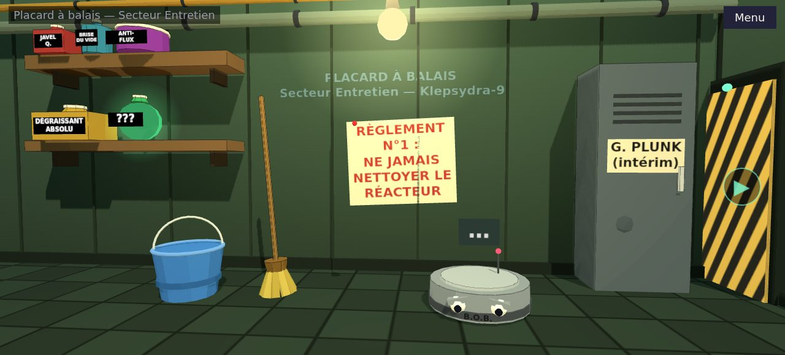
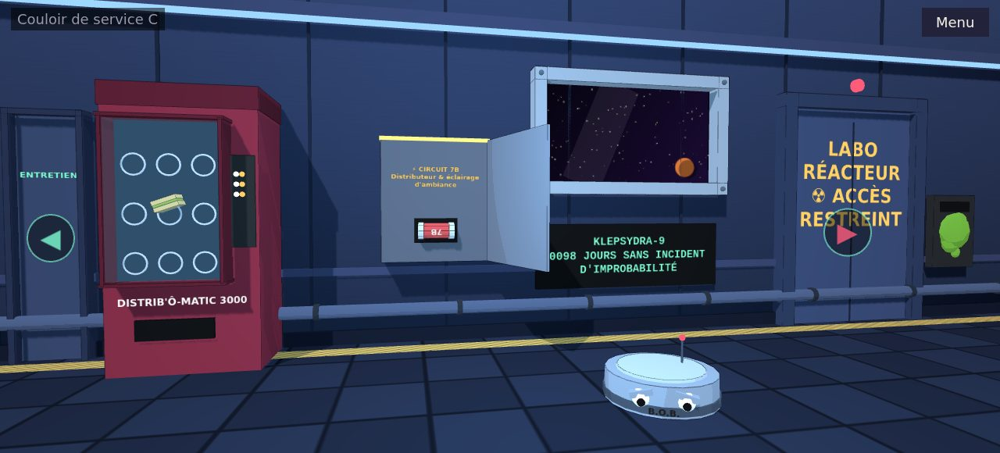
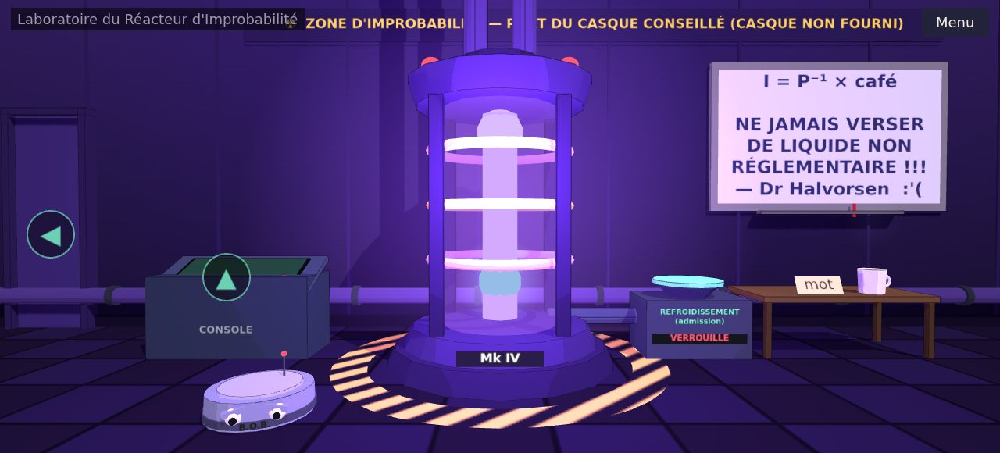
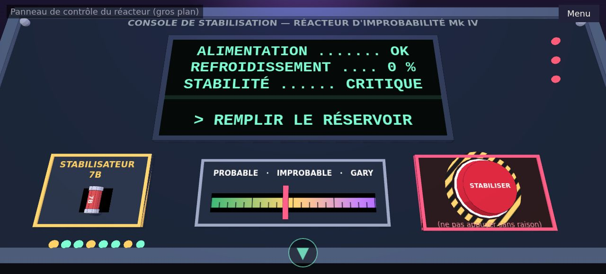

# Quantum Janitor — Chapitre 0 : « Le Seau »

Point & click narratif, *Space Quest* × *Rick & Morty*.

Gary Plunk (badge « Garry », merci la RH), agent d'entretien intérimaire sur la
station *Klepsydra-9*, renverse son seau dans un Réacteur d'Improbabilité. La
station se scinde en 4 096 réalités. Son seul allié : B.O.B., un aspirateur-robot
dépressif. Ce dépôt contient le moteur et le chapitre 0, jouable de bout en bout
en 10–15 minutes.

Rendu : salles **3D low-poly stylisées** (Three.js, greybox procédural, look
toon à la *Agent A*) sous une UI Phaser. Pas encore d'art définitif ni de
personnage animé.

| Placard | Couloir |
|---|---|
|  |  |
| **Labo** | **Panneau (gros plan)** |
|  |  |

## Lancer le jeu

Prérequis : Node.js LTS (≥ 20).

```bash
npm install
npm run dev          # http://localhost:5173
```

| Commande | Rôle |
|---|---|
| `npm run dev` | serveur de développement Vite |
| `npm run build` | validation du contenu + typecheck + build dans `dist/` |
| `npm run preview` | sert le build localement |
| `npm run validate` | vérifie les références croisées du contenu |
| `npm run playthrough` | rejoue la solution complète sans navigateur (`-- -v` pour lire les dialogues) |

## Comment jouer

- **Clic sur un élément** → menu *Regarder / Utiliser (Prendre, Appuyer…) / Parler*.
- **Clic droit sur un élément** → le regarder directement.
- **Flèches** (◀ ▶ ▲ ▼) → changer de vue.
- **Inventaire** (en bas) : clic pour prendre un objet en main, puis clic sur un
  élément du décor pour l'utiliser dessus, ou sur un autre objet pour les
  combiner. Clic droit sur un objet : l'examiner. Clic droit dans le vide : le reposer.
- **Dialogues** : clic, Espace ou Entrée pour avancer ; touches 1–9 pour les choix.
- Sauvegarde **automatique** (localStorage). « Menu » ramène à l'écran titre.

## Mode debug (URL)

```
?scene=labo&flags=labo_ouvert,bob_suit&items=seau,badge   # démarre directement ici
&debug=1                                                  # contours des hotspots + état affiché
?scene=fin                                                # saute au cliffhanger
?reset=1                                                  # efface la sauvegarde
```

Exemple : <http://localhost:5173/?scene=panneau&flags=bob_suit,labo_ouvert,sait_fusible&items=fusible,seau&debug=1>

En mode debug la sauvegarde est désactivée et l'intro de la scène de départ
n'est pas rejouée. Ids de scènes, objets et flags : voir `content/` et
`docs/STORY.md`. En dev, `window.__game` expose l'instance Phaser.

## Structure

```
quantum-janitor/
├─ src/
│  ├─ engine/        # moteur générique, sans contenu codé en dur
│  │  ├─ GameState.ts        flags, inventaire, scène courante, conditions
│  │  ├─ SaveSystem.ts       sauvegarde auto localStorage
│  │  ├─ SceneManager.ts     navigation entre vues + fondus
│  │  ├─ HotspotLayer.ts     zones cliquables + flèches (et rendu 2D de secours)
│  │  ├─ Inventory.ts        barre d'inventaire, combinaisons
│  │  ├─ DialogueRunner.ts   exécution Ink (tags → effets de jeu)
│  │  ├─ ActionRunner.ts     exécution des actions YAML
│  │  ├─ content.ts / ink.ts parsing YAML + compilation Ink (partagés avec tools/)
│  │  └─ debug.ts            paramètres d'URL
│  ├─ three/         # décors 3D (Three.js)
│  │  ├─ RoomRenderer.ts     rendu hors écran + pont vers une texture Phaser
│  │  ├─ Stage.ts            caméra fixe, projection rect écran → monde, états
│  │  ├─ kit.ts / props.ts   matériaux toon, primitives, textes peints, objets
│  │  └─ rooms/*.ts          une pièce par scène YAML (placard, couloir…)
│  ├─ ui/            # boîte de dialogue, menu de verbes, label de survol, thème
│  ├─ scenes/        # scènes Phaser : Title, Room (jeu), End (cliffhanger)
│  └─ main.ts
├─ content/
│  ├─ scenes/*.yaml  # une vue fixe par fichier : décor, hotspots, sorties
│  ├─ story/*.ink    # dialogues Ink (concaténés, `_globals.ink` en premier)
│  ├─ items.yaml     # objets d'inventaire
│  └─ game.yaml      # scène de départ, personnages (portraits placeholder)
├─ assets/placeholders/
├─ tools/            # validate-content.ts, playthrough.ts
├─ docs/STORY.md     # bible : persos, dimensions, chaîne de puzzles
└─ .github/workflows/deploy.yml   # déploiement GitHub Pages
```

## Rendu visuel : Phaser (UI) + Three.js (salles)

```
┌──────────── canvas Phaser 1280×720 ────────────┐
│  Image « room3d » (depth 0)  ← canvas WebGL Three.js hors écran,
│                                 re-rendu et ré-uploadé à chaque frame
│  HotspotLayer (depth 10)     ← zones cliquables (rect du YAML), flèches
│  HUD / inventaire / dialogues / menu de verbes (depth 500+)
└────────────────────────────────────────────────┘
```

- **Un seul canvas visible** : Three.js rend dans un canvas hors écran utilisé
  comme texture Phaser. Phaser garde la mise à l'échelle, les entrées, les
  fondus, les flashs et les tremblements — rien à synchroniser entre deux DOM.
- **Une vue = une caméra fixe** (`src/three/rooms/<id>.ts`) : `camera` (position,
  cible, fov) + `build(stage)` qui construit le décor procédural.
- **Alignement hotspots ↔ 3D** : les `rect` du YAML restent la vérité pour les
  clics. Le décor est placé *à partir* de ces rectangles en lançant des rayons
  depuis la caméra : `stage.stand(rect)` (objet posé au sol), `stage.fit(rect, z)`
  (objet mural), `stage.fitX(rect, x)` (mur latéral), `stage.fitIn(rect, groupe)`
  (surface inclinée, ex. le pupitre). Déplacer un hotspot dans le YAML déplace
  l'objet 3D. `stage.project(v)` fait l'inverse (ancre 3D → pixel), pour de
  futurs hotspots projetés / gros plans.
- **État** : `stage.spot(id, …objets)` lie des meshes à un hotspot — ils suivent
  son `if:` YAML et s'éclairent au survol. `stage.when(condition, …objets)`
  affiche/masque selon les flags (même syntaxe que le YAML : `flags`,
  `notFlags`, `items`, `notItems`). `stage.animate(fn)` pour l'ambiance.
- **Style** : `MeshToonMaterial` en 3 paliers, une lumière directionnelle à
  ombres dures, arêtes sombres (`EdgesGeometry`), matériaux non éclairés pour
  écrans/néons, textes peints sur canvas. Pas de PBR.
- **Ajouter un objet 3D ponctuel** sans toucher au reste de la vue :

  ```ts
  // src/three/rooms/labo.ts, dans build(s)
  const p = s.stand([600, 470, 80, 60]);            // rect écran où il doit apparaître
  s.when({ flags: ['seau_pose'] }, at(seau(p.w, p.h), p.x, 0, p.z));
  ```

  Les objets réutilisables vivent dans `src/three/props.ts` (B.O.B., seau,
  serpillière, fusible, flacons…). Un futur modèle Blender (glTF) se pose de la
  même façon.
- **Repli 2D** : une scène YAML sans entrée dans `src/three/rooms/index.ts` est
  dessinée comme avant à partir de son `art:` (rectangles/cercles/texte). Pour
  les quatre vues du chapitre 0, l'`art:` YAML n'est plus affiché.

## Écrire du contenu

**Scène (YAML)** — extrait :

```yaml
hotspots:
  - id: lecteur
    label: Lecteur de badge
    rect: [1180, 240, 70, 110]          # x, y, largeur, hauteur (vue 1280×580)
    if: { notFlags: [labo_ouvert] }     # visible seulement si…
    art: [{ rect: [1190, 250, 50, 90], color: "#2a2a2a" }]
    look: "Texte dit par Gary."
    use:  [{ say: "sylvie: ACCÈS REFUSÉ." }]
    useItem:
      badge:
        - if: { flags: [lecteur_propre] }
          dialogue: badge_porte          # knot Ink
          stop: true
        - say: "Encrassé."
exits:
  - { id: vers_labo, label: Labo, to: labo, dir: right, rect: [...], requires: { flags: [labo_ouvert] }, lockedText: "Fermé." }
```

Actions disponibles : `say`, `dialogue`, `give`, `take`, `set`, `unset`,
`goto`, `end`, `shake`, `stop`, avec une condition `if:`
(`flags`, `notFlags`, `items`, `notItems`). Une ligne `say` préfixée par un id
de personnage (`bob: …`) change l'orateur (Gary par défaut).

**Dialogue (Ink)** — préfixe `id:` pour l'orateur, tags pour les effets :

```ink
=== bob_sandwich ===
bob: Un sandwich ? Pour moi ? # take: sandwich
Gary récupère son badge. # give: badge
{ has_flag("bob_suit"): … }
* [Choix] gary: Réplique.
```

Tags : `give`, `take`, `set`, `unset`, `goto`, `end`, `shake`.
Fonctions : `has_flag("id")`, `has_item("id")`.

`npm run validate` vérifie : scènes cibles des sorties et `goto`, objets
référencés, knots Ink appelés, flags lus jamais posés (et l'inverse), tags et
préfixes de personnages inconnus, erreurs de compilation Ink (avec fichier:ligne).

## Déploiement GitHub Pages

`vite.config.ts` utilise `base: '/quantum-janitor/'` au build (surchargable
avec `BASE_PATH=/autre/ npm run build`). Le workflow
`.github/workflows/deploy.yml` construit et publie à chaque push sur `main` :
activer *Settings → Pages → Source : GitHub Actions* sur le dépôt.

## Hors périmètre du MVP

Son, mobile, éditeur visuel, sauvegardes multiples, succès, personnage animé,
art définitif (modèles Blender, lumière précalculée).
